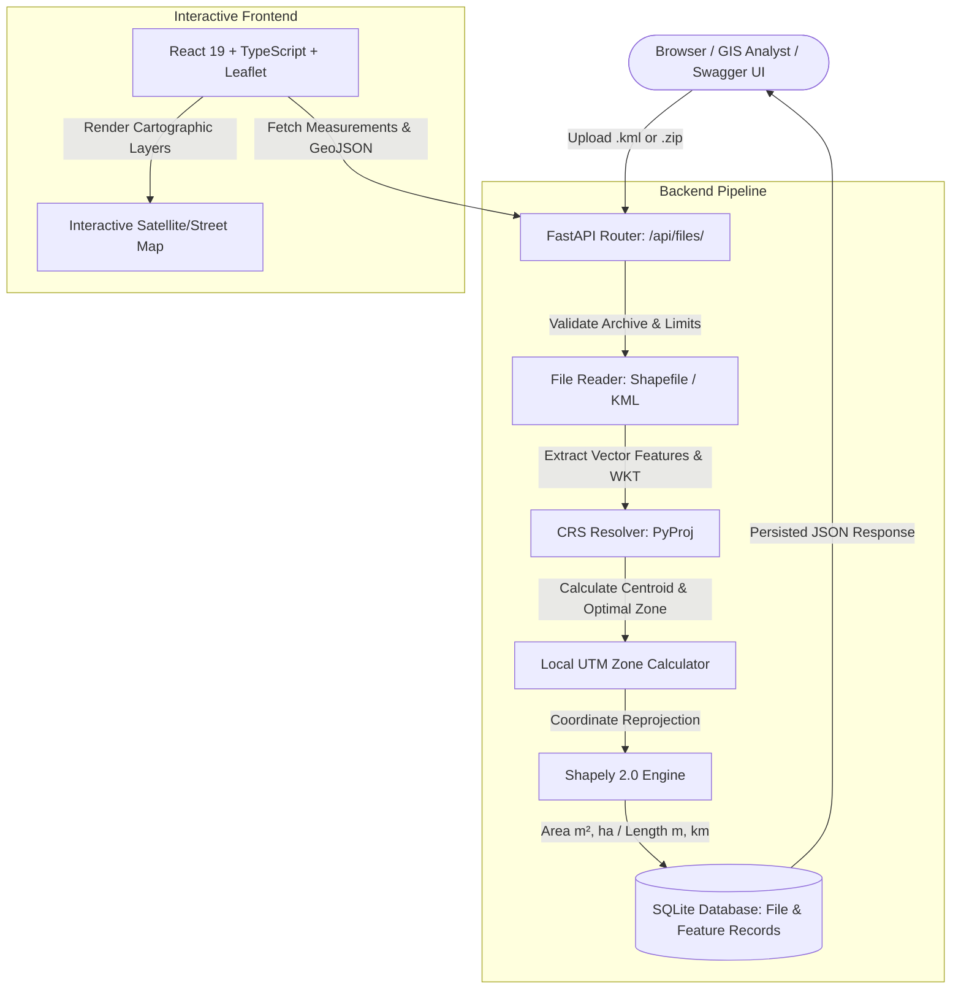

# Aereo Geospatial File Measurement Platform
> **Enterprise-grade Vector GIS Processing & Metric Calculation Engine**  
> *Developed for Aereo SDE Internship Assignment (Batch 2023–2027)*

[](https://fastapi.tiangolo.com)
[](https://react.dev)
[](https://www.typescriptlang.org)
[](https://python.org)
[](https://shapely.readthedocs.io/)
[](https://pyproj4.github.io/pyproj/)
[](https://docker.com)
[](https://pytest.org)

---

## 1. Executive Summary & Problem Statement

**Aereo** develops *Aereo Cloud*, an enterprise geospatial intelligence platform that transforms raw drone photogrammetry and survey datasets into actionable 2D/3D insights across mining, infrastructure, and utilities.

In real-world drone workflows, survey teams produce vector boundary files (**ESRI Shapefiles** or **Keyhole Markup Language - KML**) defining land parcels, haul roads, excavation zones, and monitoring stations. This project provides a production-grade backend service and an interactive geospatial dashboard to:

1. **Accept & Validate Geospatial Files:** Supports `.kml` and compressed ESRI Shapefile `.zip` bundles containing `.shp`, `.shx`, `.dbf`, and `.prj` components.
2. **Resolve Coordinate Reference Systems (CRS):** Identifies source coordinate systems (e.g., `EPSG:4326`) and transforms angular degree coordinates into an **appropriate projected metric coordinate system** (e.g., Local Universal Transverse Mercator - UTM) before measurement.
3. **Compute Accurate Metric Measurements:**
   - **Polygon / MultiPolygon:** Surface area in square meters ($m^2$) and hectares ($\text{ha}$), boundary perimeter in meters ($m$), with full support for interior doughnut holes / retention basins.
   - **LineString / MultiLineString:** Euclidean path length in meters ($m$) and kilometers ($\text{km}$).
   - **Point / MultiPoint:** Graceful status handling (no area/length applicable).
   - **Unsupported Geometries / Partial Failures:** Handled resiliently on a per-feature basis without crashing the pipeline.
4. **Persist & Serve Results:** Backed by SQLAlchemy and SQLite, providing RESTful endpoints, full OpenAPI/Swagger documentation, and an interactive **React + TypeScript + Leaflet** visualizer.

---

## 2. System Architecture



---

## 3. Repository Directory Structure

```text
c:\projects\Aereo\
├── server/
│   ├── app/
│   │   ├── api/
│   │   │   └── routes/
│   │   │       ├── files.py               # REST endpoints: POST /files/, GET /{id}/, GET /{id}/measurements/, GET /{id}/geojson/
│   │   │       └── health.py              # Health check endpoint: GET /api/health
│   │   ├── core/
│   │   │   └── config.py                  # Pydantic environment configuration & directory initialization
│   │   ├── db/
│   │   │   ├── database.py                # SQLAlchemy engine & session lifecycle dependency
│   │   │   └── models.py                  # FileRecord & FeatureRecord relational models
│   │   ├── schemas/
│   │   │   └── file.py                    # Pydantic response models (FileInfo, Measurements, Summaries)
│   │   ├── services/
│   │   │   ├── file_reader.py             # Secure Zip Shapefile and defused XML KML parser
│   │   │   ├── geometry_processor.py      # CRS resolver, dynamic UTM selector & array transformer
│   │   │   └── measurement_service.py     # End-to-end calculation orchestration & database persistence
│   │   └── main.py                        # FastAPI application entrypoint with CORS & Static routing
│   ├── tests/
│   │   ├── conftest.py                    # TestClient fixture with isolated SQLite database
│   │   ├── test_upload.py                 # File validation, upload flow, 404s, and cleanup tests
│   │   ├── test_measurements.py           # Polygon area, holes, linestring length, and point tests
│   │   ├── test_crs_transformation.py     # UTM projection math, hemisphere logic, degree vs meter validation
│   │   └── test_errors.py                 # Corrupt archives, missing .prj, and malformed KML tests
│   ├── scripts/
│   │   └── generate_sample_data.py        # Standalone generator for test fixtures
│   ├── .env.example                       # Backend environment configuration template
│   ├── pytest.ini                         # Pytest configuration
│   ├── Dockerfile                         # Production Python 3.11 backend container
│   └── requirements.txt                   # FastAPI, Shapely, PyProj, SQLAlchemy, Pyshp dependencies
├── client/
│   ├── src/
│   │   ├── components/
│   │   │   ├── Header.tsx                 # Branding, Swagger docs shortcut, and health badge
│   │   │   ├── FileUpload.tsx             # Drag-and-drop zone and one-click sample loader
│   │   │   ├── MetricsSummary.tsx         # Total area, length, feature counts, and CRS indicator
│   │   │   ├── FeatureList.tsx            # Filterable list of features with individual metrics
│   │   │   └── MapViewer.tsx              # Interactive Leaflet map with GeoJSON styling & popups
│   │   ├── types/
│   │   │   └── geospatial.ts              # TypeScript interfaces for API contracts
│   │   ├── App.tsx                        # Main dashboard coordinator
│   │   ├── index.css                      # Modern dark-mode styling and glassmorphism tokens
│   │   └── main.tsx                       # React DOM entrypoint
│   ├── .env.example                       # Frontend environment configuration template
│   ├── Dockerfile                         # Multi-stage Node build & Nginx production container
│   ├── nginx.conf                         # Reverse proxy config for API routing
│   ├── package.json
│   ├── tsconfig.json
│   └── vite.config.ts                     # Vite dev server with proxy to backend
├── sample_data/
│   ├── survey_bengaluru.kml               # Real-world Bengaluru drone survey fixture (Polygons, Roads, RTK Station)
│   ├── cadastral_parcels.zip              # Verified ESRI Shapefile bundle (shp, shx, dbf, prj)
│   ├── road_network.kml                   # Linear infrastructure test fixture
│   └── invalid_corrupt.zip                # Negative test fixture for archive validation
├── .github/
│   └── workflows/
│       └── ci.yml                         # Automated GitHub Actions CI pipeline
├── docker-compose.yml                     # Unified orchestration for backend + frontend
├── .gitignore
└── README.md
```

---

## 4. The Mathematics: CRS Handling & Measurement Accuracy

### Why Latitude/Longitude (EPSG:4326) Fails for Measurements
Geographic Coordinate Reference Systems such as **EPSG:4326 (WGS 84)** measure positions using angular degrees $(\lambda, \phi)$ on an oblate spheroid. 

1. **Angular Units vs. Linear Units:** A degree of latitude is roughly $111\text{ km}$, but a degree of longitude shrinks toward the poles according to:
   $$\Delta x \approx 111.32 \times \cos(\phi) \text{ km}$$
   At Bengaluru ($12.97^\circ \text{N}$), $1^\circ \text{ longitude} \approx 108.5\text{ km}$. At London ($51.5^\circ \text{N}$), it drops to $69.9\text{ km}$.
2. **The "Square Degrees" Pitfall:** Computing Euclidean polygon area ($\frac{1}{2} \sum (x_i y_{j} - x_j y_i)$) directly on geographic coordinates yields **square degrees ($deg^2$)**, which is dimensionally meaningless in metric engineering.

### Our Strategy: Dynamic Local UTM Zone Selection
For accurate planar measurements, the system dynamically projects coordinates to the optimal local **Universal Transverse Mercator (UTM)** zone:

1. **Centroid Extraction:** Compute the center longitude $\bar{\lambda}$ and latitude $\bar{\phi}$ of the dataset.
2. **Zone Number Calculation:**
   $$\text{Zone} = \left\lfloor \frac{\bar{\lambda} + 180^\circ}{6^\circ} \right\rfloor + 1 \quad (1 \le \text{Zone} \le 60)$$
3. **EPSG Code Resolution:**
   - **Northern Hemisphere ($\bar{\phi} \ge 0$):** `EPSG:32600 + Zone` (e.g., Bengaluru $\to \text{Zone 43N} \to \textbf{EPSG:32643}$)
   - **Southern Hemisphere ($\bar{\phi} < 0$):** `EPSG:32700 + Zone` (e.g., Sydney $\to \text{Zone 56S} \to \textbf{EPSG:32756}$)
4. **Multi-Zone Fallback:** If a dataset spans $>6^\circ$ longitude across multiple UTM zones, the system reprojects to **EPSG:6933 (World Equal Area Cylindrical)** to preserve true metric surface area without regional distortion.

---

## 5. API Reference & Contract

### 1. Upload Geospatial File
`POST /api/files/`  
**Content-Type:** `multipart/form-data`  
**Parameters:** `file` (`.kml` or `.zip` containing Shapefile)

#### Example Response (`201 Created`):
```json
{
  "id": "e9b28f73-10ac-485c-a548-cf2d406b744d",
  "filename": "survey_bengaluru.kml",
  "file_type": "kml",
  "file_size_bytes": 3314,
  "feature_count": 4,
  "crs": "EPSG:4326",
  "projected_crs": "EPSG:32643 (WGS 84 / UTM Zone 43N)",
  "status": "COMPLETED",
  "bounds": [77.591, 12.969, 77.602, 12.975],
  "error_message": null,
  "created_at": "2026-10-11T07:45:00Z",
  "updated_at": "2026-10-11T07:45:00Z"
}
```

---

### 2. Get File Information
`GET /api/files/{id}/`

#### Example Response (`200 OK`):
```json
{
  "id": "e9b28f73-10ac-485c-a548-cf2d406b744d",
  "filename": "survey_bengaluru.kml",
  "file_type": "kml",
  "file_size_bytes": 3314,
  "feature_count": 4,
  "crs": "EPSG:4326",
  "projected_crs": "EPSG:32643 (WGS 84 / UTM Zone 43N)",
  "status": "COMPLETED",
  "bounds": [77.591, 12.969, 77.602, 12.975],
  "error_message": null,
  "created_at": "2026-10-11T07:45:00Z",
  "updated_at": "2026-10-11T07:45:00Z"
}
```

---

### 3. Get Measurements
`GET /api/files/{id}/measurements/`

#### Example Response (`200 OK`):
```json
{
  "id": "e9b28f73-10ac-485c-a548-cf2d406b744d",
  "filename": "survey_bengaluru.kml",
  "status": "COMPLETED",
  "source_crs": "EPSG:4326",
  "projected_crs": "EPSG:32643 (WGS 84 / UTM Zone 43N)",
  "summary": {
    "total_features": 4,
    "calculated_features": 3,
    "polygon_count": 2,
    "linestring_count": 1,
    "point_count": 1,
    "other_count": 0,
    "total_area_sq_m": 254820.50,
    "total_area_hectares": 25.4821,
    "total_length_m": 1580.40,
    "total_length_km": 1.5804,
    "projected_crs": "EPSG:32643 (WGS 84 / UTM Zone 43N)"
  },
  "features": [
    {
      "feature_index": 0,
      "feature_id": "Zone A - Construction Site",
      "geometry_type": "Polygon",
      "properties": {
        "contractor": "Aereo Engineering",
        "phase": "Phase 1 Foundation"
      },
      "measurement": {
        "area_sq_m": 172840.25,
        "area_hectares": 17.2840,
        "perimeter_m": 1664.80,
        "length_m": null,
        "length_km": null,
        "status": "CALCULATED",
        "note": null
      }
    },
    {
      "feature_index": 2,
      "feature_id": "Primary Haul Road",
      "geometry_type": "LineString",
      "properties": {
        "surface": "Reinforced Concrete"
      },
      "measurement": {
        "area_sq_m": null,
        "area_hectares": null,
        "perimeter_m": null,
        "length_m": 1580.40,
        "length_km": 1.5804,
        "status": "CALCULATED",
        "note": null
      }
    },
    {
      "feature_index": 3,
      "feature_id": "RTK GNSS Base Station",
      "geometry_type": "Point",
      "properties": {
        "station_id": "BLR-RTK-01"
      },
      "measurement": {
        "area_sq_m": null,
        "area_hectares": null,
        "perimeter_m": null,
        "length_m": null,
        "length_km": null,
        "status": "NOT_APPLICABLE",
        "note": "Point geometry: zero planar area and length applicable."
      }
    }
  ]
}
```

---

### 4. Export GeoJSON with Measurements (Bonus)
`GET /api/files/{id}/geojson/`  
Returns an OGC-compliant standard `FeatureCollection` with all calculated metrics embedded inside the `_measurement` property dictionary, ready for import into QGIS, Mapbox, or ArcGIS.

---

## 6. Interactive Frontend Dashboard

The platform includes a high-performance web dashboard built with **React 19**, **TypeScript**, and **Leaflet**, offering instant visualization and inspection of processed survey files.

### Key Capabilities
- **Drag-and-Drop Ingestion:** Simple dropzone supporting `.kml` and Shapefile `.zip` bundles with real-time upload progress and size validation.
- **One-Click Sample Data Loaders:** Pre-configured demo fixtures (**Bengaluru Drone Survey KML** and **Cadastral Parcels Shapefile ZIP**) allowing reviewers to evaluate the system immediately without preparing test files.
- **Interactive Leaflet Cartography:** Free OpenStreetMap tile basemap (no paid API key required), auto-fitting map view to survey bounds, color-coded vector geometry styling:
  - **Polygons:** Emerald green borders with semi-transparent fill (`#10b981`)
  - **LineStrings:** Bright cyan-blue paths (`#38bdf8`)
  - **Points / RTK Stations:** Amber circular markers (`#f59e0b`)
  - **Popups:** Click any feature to open a popup showing feature ID, geometry type, and computed metrics.
- **Aggregate & Per-Feature Metric Panels:**
  - **Projected CRS Badge:** Real-time indicator displaying the auto-selected local UTM zone (e.g., `EPSG:32643 UTM Zone 43N`) or fallback equal-area projection.
  - **Metric Totals:** Total computed polygon area ($m^2$, $\text{ha}$) and total linestring path length ($m$, $\text{km}$).
  - **Feature Filter & Focus:** Filter feature lists by geometry type, click any card to zoom directly to that geometry on the map.
- **GeoJSON Export Shortcut:** Direct link to download the enriched OGC GeoJSON containing embedded `_measurement` objects.

---

## 7. How to Run Locally

### Option A: Running with Docker Compose (Recommended)
From the project root:
```bash
docker compose up --build
```
- **React Frontend Dashboard:** [http://localhost:3000](http://localhost:3000)
- **FastAPI Backend & Swagger Docs:** [http://localhost:8000/docs](http://localhost:8000/docs)
- **Health Check Endpoint:** [http://localhost:8000/api/health](http://localhost:8000/api/health)

---

### Option B: Running Manually (Python Virtualenv & Vite)

#### 1. Start the Backend
```bash
# Navigate to server directory
cd server

# Create and activate virtual environment
python -m venv venv
# On Windows:
.\venv\Scripts\Activate.ps1
# On Linux/macOS:
source venv/bin/activate

# Install dependencies
pip install -r requirements.txt

# Start FastAPI server
uvicorn app.main:app --reload --port 8000
# or simply:
uvicorn main:app --reload
```

#### 2. Start the Frontend
```bash
# In a new terminal, navigate to client
cd client

# Install Node packages
npm install

# Start Vite development server
npm run dev
```
Open [http://localhost:3000](http://localhost:3000) in your browser.

> The Vite dev server proxies `/api/*` and `/sample_data/*` requests to `http://127.0.0.1:8000` automatically.

---

## 8. Automated Test Suite

The test suite validates file ingestion, mathematical reprojection, and error resilience.

To run the full test suite with verbose reporting:
```bash
pytest server/tests -v
```

### Test Coverage Checklist (22/22 Tests Passing)
| Test Category | Test Case | Status |
| :--- | :--- | :---: |
| **Ingestion** | `test_upload_valid_kml` | PASS |
| **Ingestion** | `test_upload_valid_shapefile_zip` | PASS |
| **Ingestion** | `test_upload_unsupported_file_extension` | PASS |
| **Ingestion** | `test_upload_empty_file_rejected` | PASS |
| **Measurements** | `test_polygon_area_and_linestring_length_kml` | PASS |
| **Measurements** | `test_shapefile_measurements` | PASS |
| **Measurements** | `test_point_feature_not_applicable` | PASS |
| **Measurements** | `test_geojson_export_endpoint` | PASS |
| **CRS & Projections** | `test_utm_zone_formula` (North & South Hemispheres) | PASS |
| **CRS & Projections** | `test_crs_projection_prevents_degree_distortion` | PASS |
| **CRS & Projections** | `test_multi_zone_geographic_dataset_selects_equal_area` | PASS |
| **CRS & Projections** | `test_preserved_existing_projected_crs` | PASS |
| **CRS & Projections** | `test_parse_crs_from_wkt_and_epsg` | PASS |
| **Resilience** | `test_corrupted_zip_upload` | PASS |
| **Resilience** | `test_shapefile_missing_shp_file` | PASS |
| **Resilience** | `test_shapefile_missing_shx_companion` | PASS |
| **Resilience** | `test_shapefile_missing_prj_handled_gracefully` | PASS |
| **Resilience** | `test_corrupted_kml_xml` | PASS |
| **Resilience** | `test_kml_with_invalid_self_intersecting_polygon` (`make_valid`) | PASS |
| **Persistence** | `test_get_file_info_persisted` | PASS |
| **Persistence** | `test_get_nonexistent_file_404` | PASS |
| **Persistence** | `test_delete_file_endpoint` | PASS |

---

## 9. Design Decisions & Technical Trade-offs

1. **FastAPI vs. Django REST Framework:**
   - *Decision:* Selected **FastAPI**.
   - *Rationale:* FastAPI provides asynchronous request handling, automatic interactive OpenAPI/Swagger documentation, and native Pydantic v2 data validation with near zero memory overhead. For high-throughput geospatial ingestion microservices (such as those powering *Aereo Cloud*), FastAPI is significantly lighter and faster than monolithic Django.
2. **`pyshp` + `defusedxml` vs. Full GDAL C-Libraries:**
   - *Decision:* Implemented parsing with `pyshp` and XML tree readers wrapped with `Shapely 2.0` and `PyProj`.
   - *Rationale:* Heavy GDAL C-extension binaries often fail to install or produce conflicting dynamic link libraries (`.dll` / `.so`) across mixed Windows, macOS, and Linux environments. `pyshp` and `Shapely` provide pure wheel installations, zero external C-dependencies, and guaranteed cross-platform portability.
3. **Array-Based Coordinate Reprojection in Shapely 2.0:**
   - *Decision:* Utilized vectorized `shapely.transform()` with PyProj's coordinate array buffers.
   - *Rationale:* Avoided the deprecated `shapely.ops.transform` single-point callbacks, achieving orders-of-magnitude faster reprojection speeds for complex drone survey polygons with thousands of vertices.
4. **Resilient Per-Feature Fault Isolation:**
   - *Decision:* Wrapped each feature calculation inside an isolated `try/except` block and applied `shapely.validation.make_valid()`.
   - *Rationale:* In enterprise drone surveys, one corrupt parcel polygon or self-intersecting road must never invalidate or crash the processing of the remaining hundreds of valid features in the file.
5. **Decoupled Architecture with GeoJSON as Contract:**
   - *Decision:* Frontend communicates via REST and consumes standard GeoJSON while backend performs all CRS projection math.
   - *Rationale:* Keeps the frontend lightweight and client-side processing minimal while guaranteeing single-source-of-truth calculations on the backend.

---

## 10. Learnings & Future Scope

### Key Engineering Learnings

#### Backend & Geospatial Engineering
1. **Geodesic vs. Planar Coordinate Reference Systems:** Understanding why ellipsoidal calculations on WGS 84 (`EPSG:4326`) produce dimensionally meaningless "square degrees", and mastering dynamic projection to local conformal Universal Transverse Mercator (UTM) planes or equal-area cylindrical projections (`EPSG:6933`) for high-precision Euclidean metrics.
2. **ESRI Shapefile Specification Nuances:** Managing the strict multi-part file requirement (`.shp` geometries, `.shx` spatial index, `.dbf` dBase attributes, and `.prj` coordinate reference string) and handling ESRI's clockwise outer-ring vs. counter-clockwise inner-ring conventions.
3. **Defensive XML Parsing & Geometry Extraction:** Sanitizing Google Earth KML XML namespaces, safely ignoring styling tags (`<Style>`, `<PolyStyle>`), and extracting complex nested `<MultiGeometry>` elements including polygon inner-ring doughnut holes.
4. **Resilient Fault Isolation in Spatial Pipelines:** Implementing isolated per-feature calculation boundaries and utilizing `shapely.validation.make_valid()` to repair self-intersecting survey polygons without aborting batch ingestion.
5. **Modern Vectorized Spatial Transformations:** Leveraging Shapely 2.0's C-level NumPy coordinate array buffers with PyProj `Transformer` rather than deprecated Python-loop callbacks, yielding dramatic throughput improvements on large survey datasets.

#### Frontend & Full-Stack Web GIS
1. **GeoJSON as the Architectural Universal Bridge:** The backend stores and returns geometry in standard GeoJSON format (source CRS), while Leaflet renders it natively on the map. This separation means the frontend never needs to calculate complex projection math — it simply passes coordinates to Leaflet.
2. **Leaflet Coordinate Conventions vs. GeoJSON:** Leaflet APIs expect `[latitude, longitude]` (Y, X) ordering while the GeoJSON standard specifies `[longitude, latitude]` (X, Y). Leaflet's `geoJSON()` layer handles this transformation automatically, but custom coordinate markers require deliberate order handling.
3. **Map Lifecycle Management in React 19:** Managing the Leaflet map instance imperatively with `useRef` and ensuring rigorous cleanup handlers on unmount to prevent the `"Map container is already initialized"` error under React StrictMode.
4. **Vite Reverse Proxy & Unified Docker Deployment:** Configuring Vite dev-server proxying (`/api/*` and `/sample_data/*`) to eliminate CORS hurdles during local development while mirroring the identical Nginx reverse-proxy routing topology used in production containers.
5. **End-to-End Type Safety:** Establishing strong TypeScript interfaces (`FileInfo`, `FeatureItem`, `FileMeasurementsResponse`) matching Pydantic response models, preventing schema drift across the full stack.

---

### Future Scope & Production Roadmap

#### 1. Backend Scalability & Spatial Infrastructure
- **Asynchronous Task Queue (Celery + Redis):** Offload long-running processing of multi-gigabyte orthomosaic vector layers to distributed Celery worker nodes, notifying the frontend via WebSockets or Server-Sent Events (SSE).
- **PostGIS & Spatial SQL Storage:** Migrate persistence from SQLite to PostgreSQL with PostGIS extension, enabling native `ST_Area`, `ST_Length`, and R-Tree spatial indexing (`GIST`) for high-speed spatial queries.
- **Object Storage Integration (S3 / MinIO):** Store large raw geospatial archives and generated GeoJSON artifacts directly on S3-compatible cloud storage rather than local disk.
- **Extended Geospatial Format Ingestion:** Add support for GeoPackage (`.gpkg`), FlatGeobuf (`.fgb`), direct GeoJSON uploads, and DXF/DWG CAD engineering drawings.

#### 2. Advanced Geospatial & Photogrammetric Analysis
- **3D Surface Area & Elevation Profiles (DEM/DSM):** Integrate drone Digital Elevation Models (DEM) to calculate true 3D slope surface area and generate elevation profile charts along LineString paths.
- **Volumetric Cut/Fill Calculations:** For mining and excavation surveying, compare sequential drone surveys over time to compute stockpile volumes and earthwork movement.
- **Cadastral Boundary Encroachment Detection:** Automated polygon intersection checks (`ST_Intersection`) to highlight property boundary disputes or right-of-way violations.

#### 3. Client Dashboard Enhancements
- **Dynamic Measurement Units Toggle:** Instant client-side switching between Metric ($m^2$, $\text{ha}$, $m$, $\text{km}$) and Imperial (acres, $\text{sq ft}$, feet, miles) units without API re-querying.
- **Interactive Sketch & Measurement Tools:** Integrate Leaflet Draw / Geoman for analysts to sketch custom boundary polygons directly on satellite imagery and request on-the-fly metric calculations.
- **Side-by-Side Survey Comparison Mode:** Split-screen map comparison to inspect change detection between before-and-after survey epochs.
- **Offline Progressive Web App (PWA) Support:** Cache vector layers and base map tiles via Service Workers so field surveyors can inspect measurements without internet connectivity on-site.
- **Export Formats:** One-click export of measurement reports to CSV, styled PDF survey summary sheets, and Shapefile download.

---

## 11. Interview Preparation & FAQ

**Q1: Why can't you calculate area directly from EPSG:4326?**  
*Answer:* EPSG:4326 coordinates are angular degrees on an ellipsoid. Longitude distances shrink from $\sim 111\text{ km}$ at the equator to $0\text{ km}$ at the poles. Planar calculations on degree coordinates return square degrees, not physical square meters.

**Q2: How does the system determine the local UTM zone?**  
*Answer:* We compute the dataset centroid longitude $\bar{\lambda}$ and apply $\lfloor(\bar{\lambda} + 180)/6\rfloor + 1$. Depending on latitude sign, we assign `EPSG:32600 + zone` (North) or `EPSG:32700 + zone` (South).

**Q3: How does the system handle missing `.prj` files?**  
*Answer:* It issues a structured warning in the API response, logs the omission, and falls back to standard `EPSG:4326` geographic coordinates without crashing.

**Q4: How does the service scale to millions of features?**  
*Answer:* Stream features via Fiona/Pyogrio iterators instead of in-memory buffering, offload processing to asynchronous background Celery tasks, and persist layers in a PostGIS cluster with spatial R-tree indexing.
